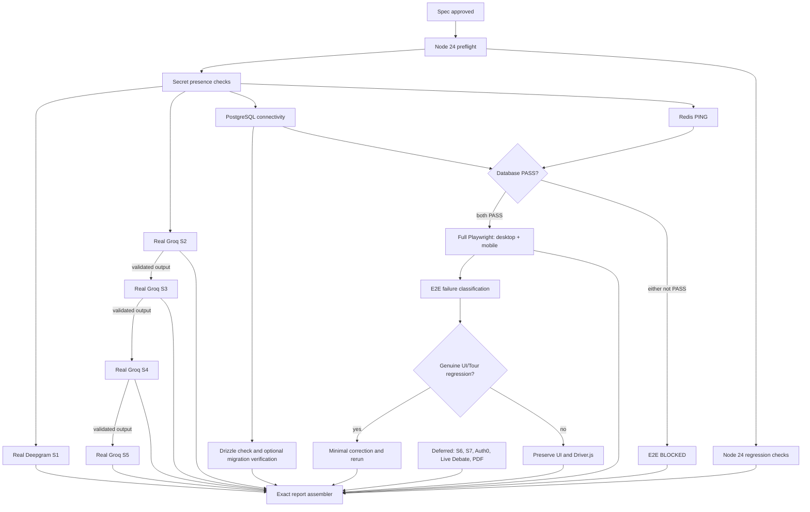

# Design Document: Final Certification

## Overview

Final Certification is an evidence-producing, secret-safe workflow for the currently supported Debate Analyser surface. It certifies real Groq S2–S5 in strict dependency order, preserves the certified Deepgram S1 baseline, verifies PostgreSQL, Redis, and the immutable Drizzle migration chain, gates full desktop/mobile Playwright on reachable infrastructure, runs the complete Node 24 regression/build set, and emits an exact factual report.

The workflow is fail-honest rather than fail-fast: every check receives an independent `PASS`, `FAIL`, `BLOCKED`, or `DEFERRED` status. A failed dependency blocks only downstream nodes; unrelated branches continue. Specification work does not execute certification, inspect secret values, modify application code, modify `drizzle/`, or claim production readiness.

S6, S7, Auth0, Live Debate, and PDF are explicit deferred boundaries. UI/UX and Driver.js changes are prohibited unless full E2E evidence identifies a reproducible application regression; any authorized correction is minimal and followed by targeted and downstream reruns.

## Architecture

The orchestration graph has no cycles. Remediation creates a new evidence attempt rather than mutating prior evidence, so historical failures remain auditable.